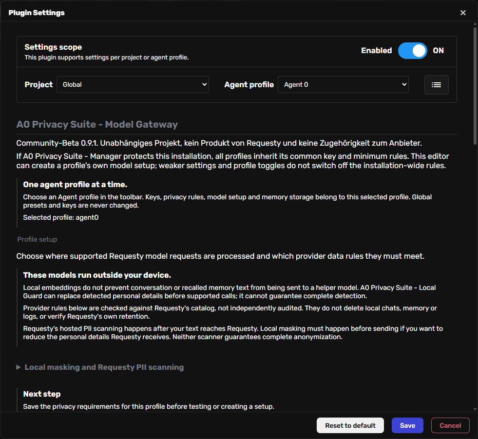

# Community beta 0.9.1 validation — 13 October 2026

## Environment and scope

Agent Zero v2.13, commit `e3051fb584b1a36be2b0a0c90606f1c2c2d356ec`, Linux Docker (`agent0ai/agent-zero:latest` at test time), framework Python 3.12.4, spaCy 3.8.16 and DE/EN model packages 3.8.0. A newly created container without host volumes or copied credentials was used. All sample identities and provider keys are synthetic. No paid model requests, real Requesty catalog credentials or Ollama calls were used. Linux CPU behavior only; Windows-native installs and other A0 releases are not certified.

## Results

- 174 Local Guard, 79 Model Gateway and 78 Manager Python tests passed in separate framework-backed processes; 38 frontend tests passed. The added Manager regression covers a dynamically loaded HTTP handler, not just the direct-import class.
- All three packages installed through A0's native ZIP installer. Before install the image lacked both English/German spaCy models; both were downloaded and successfully loaded. Installation alone left central protection inactive.
- Local preparation loaded the actual sentence-transformers embedding weights. Provider catalog and activation setup were simulated in a short-lived test process; subsequent browser/HTTP checks used the real unmodified A0 web service.
- Explicit Developer grant/new chat reported PII off with Secret screening on. Actual HTTP profile switch and project activation/deactivation permanently blocked that chat even after returning. Revocation blocked a fresh chat. All three temporary chats were removed via the native HTTP API and the temporary project was removed.
- Disabling each required component globally or in the Developer profile was rejected while the central policy was active (six attempts). Uninstalling each required component was also rejected (three attempts).
- Central deactivation through the rendered UI succeeded. All three ordinary plugin switches then worked in both directions, and native HTTP uninstall succeeded. All plugin directories and owned adapter journals were removed. Seven synthetic configuration/key/profile-state files remained byte-identical. Published dependency reinstallation and Git update are checked separately before Hub submission; see final submission evidence.
- The primary installation's previously recorded regressions are historical evidence only. This beta run does not repeat a paid autonomous cloud-chat/browser acceptance test and does not prove general PII completeness.

## Observed setup resources

Local Guard cold ZIP install: 14.271 s, process high-water RSS 680,552 KiB (about 0.65 GiB). Local model preparation: 18.914 s, process high-water RSS 1,293,356 KiB (about 1.23 GiB). English/German installed model directories occupied about 15.2/22.2 MB; Hugging Face cache after preparation occupied about 571 MB. These are process/setup and resulting-cache observations on shared development hardware, not per-chat latency, a concurrency limit, download-byte accounting, or universal system requirements. Network/cache state can change setup times. Reserve additional space/RAM for A0, concurrent chats and further languages.

## Review and distribution

All manifests have stable IDs, version 0.9.1, and no community component is marked always-enabled. Existing routes, mappings and provider constraints are retained. Persistent owned adapters prevent ordinary plugin toggles from silently disabling active central protection; uninstall requires explicit central deactivation. Missing required components/models fail closed on supported paths. Manager install hooks refresh owned adapters on an active update. Security reporting is described in root `SECURITY.md`, and GitHub private vulnerability reporting is enabled.

Review covered changed lifecycle paths, manifest compatibility, synthetic native regressions, dependency SHA-256 verification and published index metadata. This is a maintainer review, not an independent penetration test or complete audit of the host, tools or upstream providers. Known limits include incomplete PII/Secret detection, unmasked full-context Developer consent, optional login on isolated local UI, plain local key/mapping storage, image/raw-tool traffic outside text-filter guarantees, and native framework-version dependence.

## Current screenshot

The screenshot shows the real A0 plugin configuration with synthetic setup only. Historic screenshots/reports elsewhere retain original versions and must not be treated as this beta's acceptance evidence.
