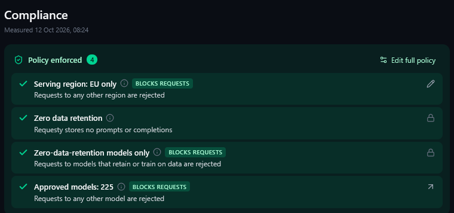

# Requesty-Konto zusätzlich absichern

Empfehlung für EU-Privatanwender, Stand 12. Oktober 2026:

1. **Serving region: EU only** und den EU-Gateway `https://router.eu.requesty.ai/v1` verwenden. Das begrenzt Requestys Verarbeitung; EU-Modellstandorte sind separat zu prüfen.
2. **Zero data retention** für Requesty aktivieren, soweit im Konto verfügbar. Inhaltslogging und Debugging für den verwendeten Schlüssel ausgeschaltet halten, falls kontoweites ZDR nicht verfügbar ist.
3. **Zero-data-retention models only** aktivieren: Anbieter dürfen Anfrage-/Antwortdaten laut ihren ausgewiesenen Bedingungen weder behalten noch zum Training verwenden.
4. **Approved Models** bewusst auswählen: EU-Modellstandort, keine Speicherung und kein Training anhand des Katalogs prüfen. Die Anzahl ist kein Qualitätsmerkmal. Die im Beispiel gezeigten 225 Modelle sind keine Vorgabe.

Kontoweite Regeln betreffen alle Anwendungen und Schlüssel dieses Requesty-Kontos. Gesperrte Regeln sind keine gewöhnlichen reversiblen Schalter; Änderungen können den Support erfordern. Nutzungsmetadaten wie Modell, Kosten und Tokenzahlen bleiben gespeichert. Bereits vorhandene Inhaltslogs werden durch spätere Aktivierung nicht rückwirkend entfernt.

Die lokale Kontocheckliste speichert nur **„vom Nutzer bestätigt“** und das Bestätigungsdatum. Sie ist keine technische Kontoverifikation, keine Zertifizierung und ersetzt keine lokale Maskierung. Bei einem Schlüsselwechsel wird die zugehörige Bestätigung ungültig. Insbesondere erfüllt eine Bestätigung niemals `require_requesty_zdr`: Dieser technische Schalter blockiert weiterhin, solange ZDR nicht verifizierbar ist.

Requestys serverseitige PII- und Secret-Prüfung ist eine mögliche zusätzliche Schicht. Die Daten erreichen dabei bereits Requesty. Diese Plugins aktivieren oder verifizieren diese Scanner nicht automatisch.

Offizielle Anleitungen: [Compliance](https://docs.requesty.ai/features/compliance-report), [Datenspeicherung und Logging](https://docs.requesty.ai/features/data-privacy). Anbieterangaben werden nicht unabhängig auditiert.
